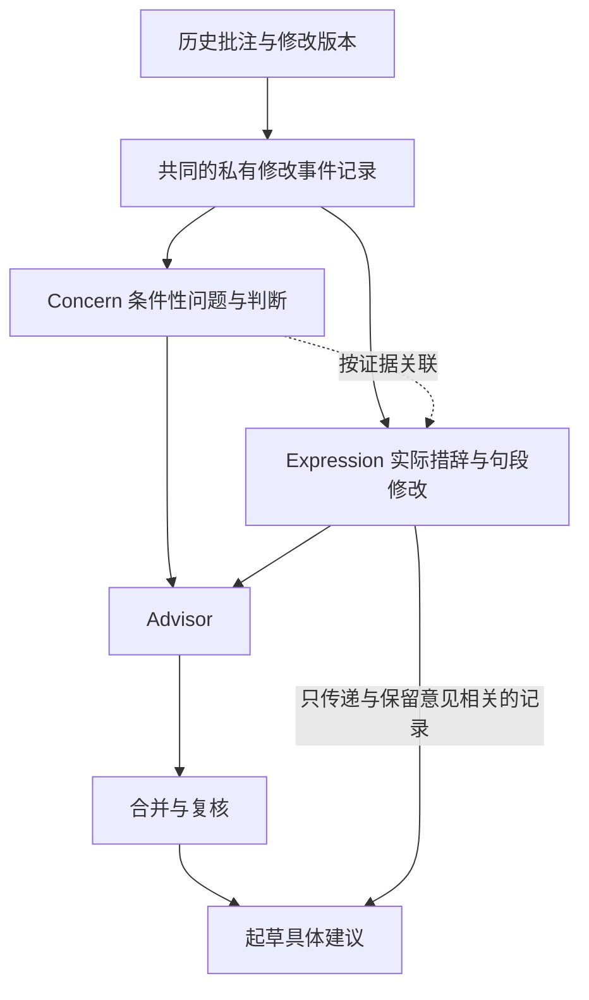

# Concern 与 Expression 学习及接入计划

更新日期：2026-10-10。状态：原选定来源学习、双库接入、关联语义核对与三组开发比较已完成；后续13个样例委托助手复核和四条长批注补学、版本响应绑定也已完成。本轮完整 Expression 库已冻结，共2,485条有效实例，完整库的Advisor任务整理与50批来源、条件和篇章动作核对已完成；完整四模块评测正在执行，导师偏好尚未验证。实施基线：当前 dev.4，延续 dev.3 的冻结知识与历史结果。

目标是让 MentorTrace 同时保留导师关心的逻辑问题、实际使用的措辞和段落改法，并在新稿中产生有依据、足够具体的篇章与行文建议。四个审阅模块统一为 Reader、Expert、Advisor、Editor。用户已批准执行，指定 gpt-6.1-sol / xhigh / Standard，并授权将本计划选定的历史原页、导师批注、上下文与评测稿件发送至 OpenAI Codex 模型服务。授权原文和每次调用记录在私有目录保存。

这里的“学习”是整理证据、建立可检索记录、在审阅中提供相关例子并验证迁移效果；本阶段不调整大语言模型参数。

## 当前基础和待完成工作

| 内容 | 当前状态 | 下一步 |
|---|---|---|
| 四模块名称 | 已完成更名；历史序列化标识保留兼容 | 后续设计和交付使用新名称 |
| Concern | 冻结库有 493 条记录，Advisor 按批次读取完整字段 | 复核是否丢失行文要求；保留旧快照，另建增量版本 |
| 优秀论文案例 | 已将 52 篇本地原论文绑定到 246 条案例及配对记录的原页与相邻页文本 | 原文与分析分开；不称为导师原话，不宣称重新认证全部符号或数学 |
| 历史事件学习 | 已完成早期89包及本轮269个完整上下文请求；约定范围8,653处已确认导师批注全部处置，没有核实的导师修改后整段如实保留缺失状态 | 逐项验证全库的实际使用；不能从批注消失推定接受 |
| 行文迁移 | 已加入 Expression 来源、应用与未采用记录、独立任务处置 | 用真实对照检验效果，不以来源链接数量代表质量 |
| 后续起草 | 已传递相关完整 Expression、原页上下文与具体来源作用；三组实际生成29条起草记录并留存核对 | 待作者事实与分析前提确认的条目不能当成可直接替换文本 |
| Expression | 完整私有v4冻结为2,485条、750个来源包；原238条原样复用，新增2,247条；旧快照保留；50批Advisor使用核对已完成 | 完成四模块、合并、复核、起草与逐项开发比较 |
| 行为效果 | 75项局部测试有通过记录，后续22项受影响检查重查通过；A/B/C与辅助比较已完成，A/B基本持平，C覆盖更广且有重复 | C有额外调用和来源输入，不能作因果归因；仍需未暴露、同预算评测及真实导师反馈 |

当前实现依据：[dev.4 机制说明](editorial-learning-dev.4.md)、[双库实际接入](expression-integration-dev.4.md)、[历史事件学习规则](../.agents/skills/mentortrace/references/editorial-learning.md)、[行文迁移规则](../.agents/skills/mentortrace/references/writing-transfer.md)。契约检查、真实对照和导师偏好判断分别记录，不能互相替代。

后续补学确认一个选材原因：Concern上下文子集没有包含全部导师成段提议。新规则要求在约定来源范围内独立选取Expression，完整保留长批注，并区分提议正文、导师讨论、提纲及占位；将实际后续正文和后续纠正另行绑定。已观察到四组后续正文对应，但执笔者与接受状态未知。用户进一步明确先完成完整Expression库，再开展完整四模块评测；当前不把样例助手复核记作人类导师偏好认证。

## 后续执行顺序与完整库完成标准

先完成约定训练材料范围内的Expression全量定向整理与冻结，再检查该完整库在Advisor中的检索和迁移，最后运行Reader、Expert、Advisor、Editor及合并、复核、起草的整稿链路。238条是保留的先前局部快照；本轮完整冻结库为2,485条。

1. **登记完整训练范围。** 复用已有来源、身份、家族与版本清单，逐家族登记原始批注、可归属正文修改、段落及章节提议、版本响应和后续纠正。独立于Concern选材，覆盖约定范围内所有家族。核对训练与评测暴露，评测材料的排除须预先登记。
2. **完成全部来源处置。** 对范围内候选记录分别登记已有有效学习可复用、需要新增学习、需重读受影响上下文、不构成独立Expression、重复或证据不足暂存。保留精确导师文本及完整句段语境，归纳具体动作、措辞作用、适用条件和反例。有效的238条及既有调用按实际来源复用；新证据影响的旧记录单独复核。
3. **核查并冻结完整库。** 每个范围内候选都有完成处置，未读或遗漏项为零；暂存项有明确原因且不进入运行指导。完成原文、身份、上下文和版本关系核查，保留零Concern关联实例，整理跨家族的条件性写法与冲突。冻结新库、范围清单、入库/暂存决定和真实消耗。“完整”不要求把不适用批注强行转为实例，也不要求解决所有无法确认的执笔者。
4. **验证Advisor使用完整库。** 运行读取冻结完整库的任务检索及条件判断，检查词句、整段、相邻段和章节任务的召回、无匹配、重复与冲突处理；复核相关源文是否到达起草。完整库作为检索范围，不将所有记录无差别塞入每次提示词。先修复已定位的检索或迁移问题。
5. **最后做完整四模块评测。** 使用冻结的完整库，保持优秀论文案例、通用规则、模型和预算安排一致，比较Concern基线、仅起草使用Expression、Advisor与起草都使用Expression。逐阶段追踪篇章动作是否保留，并检查可采用改写与事实条件。已有A/B/C只保留为局部开发对照。

四模块正式评测的前置条件是第3项完成且第4项发现的相关问题已处置。源码局部验证可随建库进行，不能据此提前宣称完整四模块效果。所有模型子调用继续使用已授权的gpt-6.1-sol / xhigh / Standard。完整材料学习调用按冻结请求执行，成功结果复用，失败先检查保存状态再明确补跑。

2026-10-09 执行范围已登记并冻结：`20261007Added` 的8组、7个已登记家族，54份含导师批注的PDF、253个批注页、3,386处已确认导师身份的批注；以及早期 `training_papers` 的15个文件夹。早期146份PDF中，16份与新增目录字节完全相同，复用相应学习；其余130份有109份包含已确认导师批注，共528个批注页、5,267处导师批注。完整已确认范围合计8,653处，不把新增目录单独称为全库。文件夹不自动等于独立论文家族，已知重合与可能的同稿关系单独登记。

原238条实例绑定的554处批注复用；新增目录其余2,832处按73个冻结请求读取，早期材料按196个完整上下文请求处理，其中8处相同事件及全文语境复用。非空批注与空白删除线、插入符号、高亮均登记；早期另有64处作者身份不明批注，保留身份待确认，不提供导师 Expression 权威。每处已确认批注必须有学习、不构成Expression、证据不足暂存或有效复用等处置，完整库才能冻结。原始文件、旧快照和旧试点保持不变。完整库冻结前不启动四模块模型评测。

本轮四模块沿用此前P08开发稿，预先排除该稿整个家族的Expression，并保守排除早期 `Xianzhen_2` 同主题、可能同稿的记录；完整训练库保留这些来源。Concern和开发规则的历史暴露仍存在，结果标为开发验证，不称为未见家族泛化。A/B共用相同冻结意见，C独立使用双库；Reader、Expert、Editor只在请求、原页和规则一致时复用，保留真实调用来源。

完整学习的269个请求均已完成，未处置批注为零；802条候选记录因证据或条件不足暂存，不进入运行指导。新增有效实例按作用范围为：句子1,171条、段落362条、论证单元420条、章节160条、跨章节107条、全文27条。字段与范围统计不替代适用性或导师偏好判断。评测检索范围排除202条目标家族相关记录，保留2,283条；学习库本身保留完整来源。详细来源范围、覆盖账本、冻结哈希与已报告消耗见[完整库训练记录](../private/analysis/2026-10-09-expression-full-library/完整Expression库.zh-CN.md)。

## 同源证据和两个知识库

Concern 回答“导师在什么条件下关心什么、什么解释才足够”。Expression 回答“导师在这个具体语境中怎样措辞、选择信息、安排句子和修改段落”。两者从同一份历史证据中提取，彼此可以关联，但任何一方都不要求先有另一方。

| 历史证据 | Concern | Expression |
|---|---|---|
| 导师指出缺少适用条件，没有提供替换文本 | 有条件性问题时保留 | 不虚构改写；保存来源事件即可 |
| 导师改了主语、限定词或衔接句，尚不足以提炼完整问题 | 不强行造一条 Concern | 保留实际表达变化及其语境 |
| 导师重排一个段落，并解释这样修改的理由 | 保留理由及适用条件 | 保留完整修改、句子分工和顺序变化 |
| 学生根据导师意见自行改写，未见导师确认 | 可以关联原 Concern | 标为学生响应，不作为导师实际措辞 |
| 修改人或版本先后不明 | 保留可确认部分及限制 | 存入待核实记录，不进入“导师确认改写”检索集 |

关联允许多对多：一个段落修改可以回应多个 Concern，一个 Concern 可以有不同写法。不得为了双库对齐而增加、删除或合并原本不同的要求。逻辑与语言也不完全分属两个库：限定语的一处修改可能改变科学主张，Concern 本身也可能关心信息顺序。

## 实际措辞与段落怎样保留

每条 Expression 同时保留原始证据和分析说明，分析不能覆盖原文。

| 记录部分 | 必须保存的内容 | 用途 |
|---|---|---|
| 来源与身份 | 事件、论文家族、版本、定位、文件哈希；批注者和修改者分别记录 | 能回到实际来源，避免把学生修改算成导师语言 |
| 修改前 | 原句或原段，必要的前后文，段落在章节中的任务 | 判断修改解决了什么 |
| 修改后 | 导师实际给出的句子或段落；没有完整改段时保留真实片段并注明范围 | 保留用户所要的具体写法 |
| 变化位置 | 删、加、替换、移位、合并、拆分及相应文本片段 | 支持并排查看和逐处说明 |
| 修改作用 | 句子角色、信息重点、逻辑关系、主张强度、衔接和术语选择 | 从实际写法提炼可迁移区别 |
| 事实边界 | 哪些事实没变，哪些技术内容也发生变化，哪些前提不能丢 | 避免把事实修改误当成纯润色 |
| 条件与反例 | 适用读者任务、不适用情形、其他可接受写法、后续纠正 | 避免把局部处理变成万能模板 |
| 证据强度 | 导师确认改写、明确要求、学生响应、分析推测分别标识 | 区分“导师写过”和“模型认为导师可能喜欢” |
| 关联 | 零个或多个 Concern、其他 Expression、冲突记录 | 支持联合检索，保留独立存在的记录 |

需要完整段落才能理解的修改必须保留完整段落，必要时保留相邻段落。仅有局部替换时，不让模型补造一个“导师修改后段落”。移位与多处协同修改按同一个事件组织，仍能看到每个独立动作。

原始文件只读保存。原话、研究细节、身份和全文片段保存在私有证据层；另有可供本地运行读取的私有 Expression 快照。可公开部分只包含匿名分析、检索信息与不透明来源关联。匿名摘要不能代替原文：没有取得私有证据层的运行必须明确说明无法提供对导师具体措辞的直接学习。

## 学习内容与偏好证据

Expression 覆盖五种尺度，不能仅收集词汇替换：用词与限定语、完整句子、段落、相邻段落、章节之间的信息安排。训练时分别标注，以免句子级修改掩盖整段重组。

重点阅读主语如何选择、动词与主张强度如何调整、条件放在何处、哪些信息前置、重复怎样压缩、贡献如何区分、段尾如何落到结论、下一段如何承接。每项分析必须指出真实变化，不能只写“更清楚”“更简洁”。技术条件的增删必须单独解释。

拟采用四级状态：单次局部改法、待验证的条件性偏好、有跨论文家族支持的条件性偏好、存在冲突或尚未核实。至少两个独立家族中的可归属证据只是进入跨家族复核的必要条件，不自动证明稳定偏好。重复备份和同稿多个版本不增加独立支持数；没有再次批评也不等于接受。

对优秀论文案例继续学习写法的组织和依赖关系，由 Reader、Expert 使用。导师推荐过论文只证明其推荐关系，不证明每一种句式都是导师偏好，也不把公开论文原文改标为导师 Expression。

## 四个模块及起草环节怎样接入

| 环节 | 输入与职责 | 本次拟增加的部分 |
|---|---|---|
| Reader | 独立读全文，判断读者理解、信息选择、段落和篇章组织；读取任务相关优秀论文案例 | 改善案例到具体句段建议的迁移记录，不直接读导师双库 |
| Expert | 判断技术关系、前提、推导、实验和结论支持；读取相关技术案例 | 保持技术把关职责，不承担导师风格模仿 |
| Advisor | 独立读全文，用 Concern 和 Expression 进行有条件的审阅 | 双库联合使用，既发现逻辑要求，也提出有来源的措辞和篇章动作 |
| Editor | 独立检查语言、术语、符号和格式 | 保持语言正确性职责，不把导师可选偏好判为语法错误 |
| 合并与复核 | 根据本稿证据裁定各模块建议并处理重合和冲突 | 保留独立篇章要求及 Expression 关联，不因没有技术错误而删去合理行文改善 |
| 建议文本起草 | 根据复核保留的要求生成可供采用的句段 | 接收相应 Expression 原文和边界，生成适用于本稿的表达，并逐项解释来源作用 |
| 最终交付检查 | 检查事实、条件、引用、术语和独立修改要求 | 检查是否抄入旧稿事实、误标导师原话或漏掉已保留的段落动作 |

Expression 的主要入口在 Advisor 发现意见之前，第二个入口在复核之后的起草阶段。只在合并后提供会遗漏那些必须看到导师实例才能发现的行文问题；只在 Advisor 提供而在起草时丢掉原文，又会把具体写法压缩回泛泛建议。

Advisor 保持对 Reader 和 Expert 的独立性。它的篇章任务图和检索查询从本稿自行形成，不使用其他模块的发现或判断。合并之后才汇总各模块已冻结的结果。Expression 是 Advisor 内部知识输入，不增加第五个审阅角色。

## 检索与运行的具体安排

Concern 继续保持目前的完整批次覆盖，初期不因加入 Expression 改成只检索少量 Concern。Expression 使用两条入口的并集：与当前 Concern 关联的实例，以及从本稿读者任务直接匹配的实例。后一条入口确保“有写法但没有完整 Concern”的记录也能参与。

拟在 Advisor 内增加独立任务整理与检索步骤。任务整理只陈述本稿段落功能、现有组织和需要检查的关系，不预先输出缺陷结论。检索先用章节任务、修改尺度、修辞关系和证据状态筛选，再比较候选的完整语境。初版优先使用透明索引和现有模型判断；是否需要向量检索，留给召回表现决定。

检索记录保存查询、候选、选中或未选中原因、来源状态和实际送入内容。每个任务先用少量完整实例做试点，容量由真实上下文预算确定；不固定要求每段都命中案例。命中很多近重复实例时减少重复证据，保留相反处理和不适用条件。没有相关实例时允许 Advisor 按本稿分析，并明确没有导师写法支持。

与 Concern 关联的实例可随该批次送入。只有 Expression 的任务分配到 Advisor 内明确的任务批次，保证有对应的完成或未完成记录；不能依赖某个 Concern 恰好触发。每个任务有确定的处理位置，同一实例在不同任务重复使用时保留同一来源 ID，不重复计算独立证据。

新增任务整理可能增加模型调用；是否能并入现有调用必须先用试点验证隔离、覆盖和容量，不能预先宣称零额外成本。超出预算时按完整任务拆分并记录未完成范围，不截断关键上下文或静默丢掉任务。

## 每条行文意见和最终改写的要求

Advisor 对适用的 Expression 应给出：目标段落、当前句子分工、相关实例、可迁移区别、适用与不适用原因、要保留的事实，以及具体动作。结论允许修改、保留、无匹配或待核实。该有整段处理时必须说明整段如何改，不能退化为某一个连接词的替换。

最终建议至少回答：哪句话或哪段需要处理；目前安排造成什么具体问题或改善机会；保留、删减、移动、补充或重写哪些内容；条件和信息依赖如何保留；是否有事实需要作者补充。相邻段落联动时给出协同动作，而不是孤立修改后留下衔接断点。

最终替换文本仍由大语言模型根据本稿生成。来源记录分别标明导师实际文本、模型对其作用的分析、模型为新稿拟写的文本。拟写可以借鉴主张强度、句法安排和段落组织，但不能复制原稿研究结论、数字、变量含义或未在本稿成立的条件。

每段实际交付的改写关联保留意见、目标原文证据、使用的 Concern 和 Expression，以及具体借鉴之处。没有来源贡献时记为本稿分析，不补挂来源以显得个性化。事实不足时提供可支持的部分与待补信息，不把占位假设写成完整事实陈述。

必要修复和可选改善分别保留。评价“意见更多”时统计有独立价值的动作与覆盖范围，不要求每段都改，不把同一意见换词拆成多条。

## 分阶段训练与开发

以下数量是建议的试点规模，不是已有成果或强制产出配额。范围与预算以审核后的方案和实际材料为准。

| 阶段 | 具体工作 | 交付物与完成标准 |
|---|---|---|
| 1 来源与暴露核对 | 复用已有清单、身份确认和哈希；核对选定材料的家族关系、版本链、现有 Concern 关联、训练及评估暴露 | 来源登记、可读范围、待核实项、训练与评估划分；不重做有效的既有提取 |
| 2 小批真实样例 | 建议选 3–5 个有可归属修改的论文家族，整理约 30–50 个候选事件，覆盖词句、段落、移位，以及只有 Concern 或只有 Expression 的情况 | 真实修改前后并排样例、作者身份、条件解释、双库关联和未入库原因；材料不足则如实减少 |
| 3 记录与检索接通 | 固定事件和 Expression 格式；实现私有快照、检索、Advisor 输入和应用记录；扩展起草来源包 | 最小流程能处理关联实例、独立 Expression、无匹配、冲突和未完成任务；兼容旧运行 |
| 4 全量定向整理 | 按已审核的材料范围逐家族处理未覆盖修改；对 493 条 Concern 做行文信息保留核对，重读确有遗漏或归属问题的来源 | 新 Expression 快照；Concern 的复用、补充、新增、合并或暂缓决定；不以数量增长为目标 |
| 5 整稿试运行 | 先在已知材料上检查建议颗粒度、合并保留与起草质量，再运行符合隔离条件的评估 | 原始意见、合并处置、改写、来源归因与错误清单；开发样例不冒充泛化结果 |
| 6 冻结与交付 | 修复已经定位的问题，冻结通过验收的数据与协议；完成适用局部测试与说明 | 私有 Expression 包、适用的 Concern 新版本、代码与 Skill 文档、评估报告；旧快照不覆盖 |

上述小批规模为初期试点方案，89个已有上下文包和局部三组开发对照已完成。用户随后授权全量学习：约定历史范围已按269个请求完成来源处置；完整493条Concern参与本轮A/C各50批独立Advisor检查。C的50批来源核验包括31批原始独立核验直接通过、16批明确的原文定位修正，以及3批定向实质修正和新的独立复核。原始判断与修正记录分别保留；C增加的来源核验和修正调用如实披露，不能把A/C差异解释为因果效果。完整四模块链路正在执行；未暴露评测与真实导师反馈仍未完成。相同设置和发送授权持续有效，不逐批重复请求许可。

## 评估设计与拟议验收标准

先登记历史暴露，再划分评估家族。已进入 493 条 Concern、人工设计规则或开发样例的材料，不能仅因其未进入 Expression 就当作完全未见材料。优先使用未暴露的独立论文家族；若只能重用旧家族，需要重建排除该家族派生知识的对照库并审计其他泄漏，否则结果仅用于开发诊断。

为了区分“发现问题”和“改善写法”，设置三组，保持本稿、模型、推理强度、通用规则和优秀论文案例相同：A 为当前 dev.4 的 Concern 基线；B 在相同冻结意见后仅向起草提供 Expression；C 在 Advisor 和起草两个位置都提供 Expression。B 对 A 检查表达帮助，C 对 B 检查提前接入对发现篇章问题的帮助。B 的起草阶段若发现新问题，单独记录，不计入冻结意见的发现覆盖。

比较时统一任务范围和可用预算；记录实际调用数、输入输出量、耗时和未完成任务。若 C 使用更多调用或阅读范围，必须披露，并在需要归因时增加同预算通用审阅对照，不能将全部收益归因于 Expression。dev.3 与 dev.4 的整体比较另作版本比较，不与双库消融混为一谈。

评分材料隐藏组别，先冻结候选结果，再让评估者接触导师参考。评价标准覆盖明确的参考要求，也允许识别参考修改之外合理的新建议；导师某次修改不是全部合理写法的唯一答案。模型评分只能作为辅助；只有用户或导师实际给出的评价才标为其偏好判断。

| 维度 | 评价方法 | 拟议标准 |
|---|---|---|
| 来源与身份 | 核对原文、定位、哈希、修改者和实际送入记录 | 入库与交付记录均可追溯；不得把未知或学生改写标成导师原话 |
| 篇章覆盖 | 对照独立可执行要求，统计选择、强调、顺序、承接和整段组织的命中与遗漏 | 报告分尺度覆盖；双库方案应呈现实际新增有效覆盖，不能只增加措辞类条目 |
| 意见有效性 | 对有独立动作的意见判断是否有目标证据、条件是否成立 | 建议试点目标为至少 90% 可成立；同时报告分母、样本规模和每个误报，不把小样本比例当保证 |
| 具体性 | 0 为泛泛评价，1 为指出位置，2 为给出明确动作和理由，3 为可执行的句段方案并保留依赖 | 双库方案应提高 2–3 分意见比例，分别报告词句与段落层级 |
| 事实与条件 | 对每个改写核查数字、符号、结论强度、前提和引用 | 不得有已知未修复的实质性事实新增、矛盾或关键条件丢失 |
| 导师契合度 | 对相同目标片段盲评：接近的具体方面、偏离之处、是否可采用 | 记录逐项理由及偏好、平局、无法判断；未得到真实评价时不宣称已符合导师偏好 |
| 可采用性 | 检查整句或整段能否使用，或是否只差明确待补事实 | 对无法采用的文本注明失败原因，比较各组实际可采用数与比例 |
| 合并保留 | 对照原始独立行文要求和最终动作 | 每项保留、合并、收窄、撤回或未解决都有依据；不得静默丢失 |
| 资源消耗 | 记录输入输出量、调用次数、实际可获取的费用和耗时 | 在审核预算内；成本和收益同时报告 |

达不到目标时先定位来源归属、检索漏召回、迁移误判、合并丢失或起草失真中的具体原因，只重做受影响部分。不能通过增加意见配额、重复调用直到满意或只展示最好的例子来通过验收。小样本结果用于决定下一步，不能证明对全部论文都有效。

## 拟修改的文件与协议边界

| 现有位置或拟新增组件 | 拟承担的工作 |
|---|---|
| `scripts/editorial_learning.py` | 复用事件校验，增加可保留导师实际文本的 Expression 提取与入库检查 |
| 拟新增 Expression 存储与检索组件 | 管理私有原文快照、索引、双入口检索、证据状态和冻结清单；具体文件名在实现时确定 |
| `scripts/mentortrace_v1.py` | 在新协议中冻结所用 Expression 版本及选取结果，接入 Advisor；旧协议不自动升级 |
| `scripts/writing_transfer.py` | 增加导师 Expression 来源类型，保留应用、保留原文、不适用、冲突与未完成记录 |
| `scripts/prepare_revision_proposals.py` | 传入与复核保留意见相关的原始写法及边界，绑定最终报告中的实际改写 |
| Skill 及相关参考文档 | 同步双库职责、检索、学习、起草、来源归因和私有资料使用边界 |
| 对应局部测试 | 验证来源归属、Expression 独立命中、旧协议、原文保真、串联完整性和来源隔离 |

不更改四模块命名，不覆盖现有 Concern 和案例快照，不将原始私有句段放入公开发布目录。Expression-only 的方案也必须能走通；双库不能被实现为“每条 Concern 附一个模板”的固定结构。

## 执行设置和本次审核事项

模型调用默认使用 Standard，`service_tier="default"`。保留用户已明确授权的模型与推理强度；如果后续调用无法确认适用设置，再在调用前补齐，不自行指定新模型或改变强度。输入、规则和设置未变时复用有效结果，失败或中断先检查已保存状态再决定是否重试。

总成本不在缺少素材量、上下文长度和适用模型设置时虚报。阶段 1 给出待处理规模，阶段 2 记录真实消耗，据此估算全量及评估预算。复核尽量与相关材料合并，独立性要求和必要原文不能为了节省输入而省略。

设计、调用设置和本轮资料发送范围已经获批。下一次审核查看实际导师原文样例、暂缓项、三组开发结果和真实消耗，确认条件解释是否合理，并决定其余历史材料的全量处理规模。未经用户或导师实际评价，保持“导师契合度未验证”。
