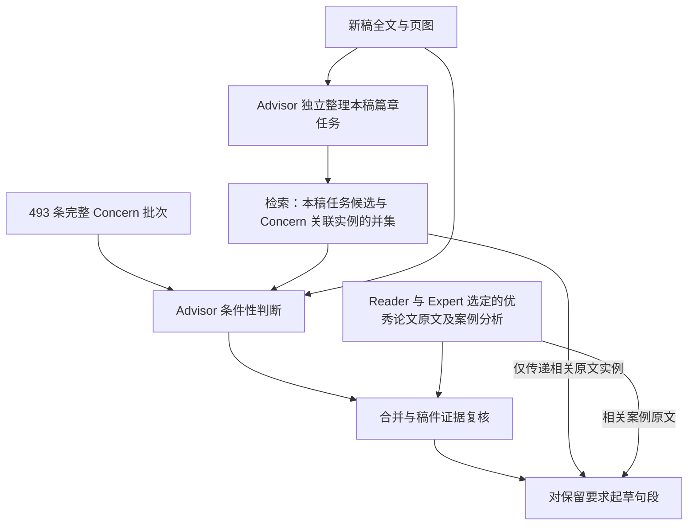

# Concern 与 Expression 的实际接入

本地 v1.2 普通新运行已改为两个库直接独立审阅全文，不生成前置任务地图，按容量与审阅负担共同分批。Reader／Expert 保留对象规划。下文任务地图与检索路径说明保留 v1.1／dev.4 的历史含义；当前执行以 [v1.2 分批规则](../.agents/skills/mentortrace/references/advisor-batching.md) 为准，旧冻结运行不迁移。

v1.1.0 已将准入复查保留的 1,581 条 Expression 放入 `corpus/advisor-expression-v1`，与 skill 同仓提供，普通新稿运行默认在 Advisor 和起草两处加载。原始批注、原页及私有映射不随包分发。下文开发阶段的 238／2,485 条等数字保留其历史含义；它们不是正式版默认库的数量。

当前实现已接通双库。Concern 保留完整六字段条件判断；私有 Expression 快照保留导师实际批注、具体动作、原页上下文、适用条件和不能迁移的事实，最小化快照则省去原始页和批注。两库允许多对多关联，也允许独立记录。学习是整理和检索证据，不更新模型参数。

## 运行路径



新增 `advisor_tasks` 属于 Advisor 内部准备步骤，先于通用对象规划，不接收 Reader 或 Expert 的发现。它陈述当前段落任务和关系，不先判断缺陷。透明词项索引提供候选，再由 Advisor 看完整来源语境判断。词项命中本身不代表适用；无命中任务仍需检查本稿。每个任务有处理位置和完成或未完成记录。

Concern 正式运行仍覆盖 493 条完整卡片。关联实例随对应批次进入；独立 Expression 由本稿任务直接召回。复核以后，起草包只携带与保留要求连接的完整实例和来源页；起草记录指明实际原文摘录、借鉴动作、目标应用和不能照搬的部分。最终建议文本由模型为新稿生成，不能标为导师原话。

与保留要求连接的实例还须递归携带`local_reference_bindings`中明确标为`admitted`的配套实例及完整来源语境。不能只在最初检索时带入配套实例，合并后又因其未被单独引用而丢掉。起草可使用有明确连接的配套来源，并记录其真实ID与借鉴动作；`held`关联和不相关实例仍不提供指导。本轮完整四模块运行定位并修复了这一来源传递遗漏；旧输入和原始学习库保留，相关局部及流程检查通过。

## Expression 输入与兼容

```powershell
python scripts/mentortrace_v1.py create --paper PAPER_PACKAGE --run NEW_RUN --expression PRIVATE_EXPRESSION_SNAPSHOT
python scripts/mentortrace_v1.py create --paper PAPER_PACKAGE --run NEW_RUN --expression MINIMIZED_EXPRESSION_SNAPSHOT
python scripts/mentortrace_v1.py create --paper PAPER_PACKAGE --run NEW_RUN --expression PRIVATE_EXPRESSION_SNAPSHOT --expression-mode draft_only
python scripts/mentortrace_v1.py create --paper PAPER_PACKAGE --run NEW_RUN --case-passages PRIVATE_PUBLISHED_PASSAGES
```

默认 `advisor_and_draft` 为两处接入，省略 `--expression` 即使用随包库；`--expression PATH` 显式替换快照，`--no-expression` 关闭 Expression 以建立对照基线。`draft_only` 在发现阶段不读取 Expression。输入快照、任务图、检索结果、送入内容与结果哈希均冻结；已有运行不会自动升级。Expression 可与 `--case-passages` 同时使用。

原始案例页文本只进入 Reader/Expert 已选择的案例和相关后续起草包，Advisor 不读取这份案例目录。本地 52 篇原论文已对应 246 条案例及配对记录；原页和相邻页文本与分析摘要分别保存。PDF 提取文本不代表符号、引用或定理重新认证，也不把尚未验证的写作配方恢复为通用规则。

私有 Expression 使用 `scripts/expression_runtime.py` 建库和检查。`records.json` 与 `episodes.json` 分别保存分析和完整来源包；`mentor_texts` 必须与归属已确认的批注全文一致。仅空白格式等价的恢复有单独日志，不修改原始模型输出。`context_episode_ids` 保留已送入的相邻原页，与确有导师批注的 `episode_ids` 区分；相邻上下文不能被标为导师措辞。

## 本轮范围和验收界限

后续新稿准备改用 PDF 阅读顺序提取，避免双栏交错使整句/整段无法定位。已有冻结输入不修改；实际试点中的视觉摘录另有页图定位修正和原始输出日志，公式仍由页图决定。案例迁移新增 `excerpt_basis`，明确区分论文原页文本与分析者重构，并核对摘录是否确实属于所选层。

首轮样例快照冻结 60 条局部实例。此前选定 5 个家族的 89 个既有上下文包全部完成独立读取，每份均有处置记录，来源学习快照冻结236条局部实例，28条候选暂缓。选定的20条关联语义核对后，运行快照更新为235条、1条暂停迁移，旧236条记录完整保留；其余实例没有全量独立语义认证。它们是先前 Concern 开发材料；没有已核实修改后版本的记录如实保存“不可确认”，没有拼造导师改写后整段。当时其余历史材料的全量整理尚未完成，该局部阶段不能称为完整来源覆盖。

2026-10-09后续段落学习发现，上述89包由Concern上下文筛选，漏掉四条直接给出成段提议的导师长批注。单独学习后，三条完整原文与有条件的篇章动作进入新私有快照，当时运行库为238条；一条定义、索引及定理方向仍冲突的候选暂存。完整旧235条记录保留。新增材料无关联Concern，证实Expression选材和检索需要独立入口。

同时绑定四组实际后续正文对应关系，并保留后续导师纠正。其中一条最初选中的后续页只有路线说明，补核更后面的两页才看到对应小节；请求与原始输出保持原样，补核标为当前助手本地复核。后续正文执笔者及导师接受状态仍未知，不称为导师最终改写。未解决的公式、引用和科学断言作为`held_operations`留存，不参与迁移。旧A/B/C比较没有重跑或改分；新增一次来源学习及13项局部测试分别记录。

开发对照使用同一篇完整 5 页稿件、同一模型/推理强度/Standard 和 12 条完整 Concern 子集。A 为 Concern 基线，B 复用 A 冻结要求并只在起草用 Expression，C 在独立 Advisor 和起草都使用。目标家族的 Expression 被排除，但历史开发暴露仍存在。C增加任务图调用与来源上下文，实际试点还需一次定向补齐来源记录的调用，该补齐没有新增意见；没有同预算通用对照，差异不能全部归因于 Expression。该试点只检查 Advisor 行文路径，不是完整四模块评测。

截至2026-10-09，三组开发比较与辅助评估已完成。A/B各7条起草记录、C为15条；C含拆分与重复动作，不能将条目数当成独立问题数。辅助比较认为A/B基本持平、C覆盖更广且有重复，没有指出实质性新增事实错误；这些判断不等于全部文字可直接采用，也不认证导师偏好。具体原文摘录、借鉴动作、待作者确认事项和实际用量保存在私有审核包。

契约检查只证明来源、独立性、覆盖、兼容和传递机制；机械入库不证明语义解释必然正确。模型辅助评估不等于真实导师评价。首轮样例、原始请求、暂缓原因、实际用量和评测结果只保存在私有审核包。

本轮完整历史学习的269个冻结请求已完成：约定范围包含8,653处已确认导师批注，未处置为零，私有v4库共2,485条有效实例、750个来源包。原238条原样保留，新增2,247条；802条证据不足候选暂存，不进入运行指导。早期64处身份未确认批注也不提供导师措辞权威。完整库已更新到私有配置；评测检索范围预先排除当前目标家族及可能同稿关系的202条记录，保留2,283条。截至2026-10-10，完整库C组Advisor的50批来源与条件核对已完成：31批原始独立核验直接通过、16批完成明确的原文定位修正、3批完成定向实质修正并经新的独立复核。原始输出与修正分别保存；C有额外核验和修正调用，A/C不能作因果比较。后续四模块链路正在执行，当前不把此前局部A/B/C当作完整四模块结果。

运行视图保留完整原页、相邻语境、批注和版本关系。明确删除线可以支持删除动作，但被删的作者文本不成为导师原话；空白高亮或插入符号不能虚构措辞。`language_choices.proposal_source_match`区分实际导师原文摘录与模型提炼的非原文措辞模式；最终为新稿生成的文本仍是模型拟写。具体借鉴须绑定真实原文、适用条件与目标动作，不能直接继承历史论文事实。完整来源范围及进度见[执行计划](concern-expression-plan.zh-CN.md)与[完整库训练记录](../private/analysis/2026-10-09-expression-full-library/完整Expression库.zh-CN.md)。

完整库的750个来源包均保留`after.status: unavailable`：当前不能确认已实际实施、且由导师执笔或认可的改后整稿。另存的后续正文及对应关系仍可提供语境，但不因此成为导师最终改写。2,064条`mentor_wording`记录指向原批注中明确给出的措辞或措辞提议；421条`explicit_editorial_action`记录指向明确的行文操作。这些标签不等于已采用的改写对，也不代表导师对新稿的接受度。该来源界限单独记录在[完整库语义界限](../private/analysis/2026-10-09-expression-full-library/LIBRARY_SEMANTIC_LIMITS.json)，原冻结来源不修改。
